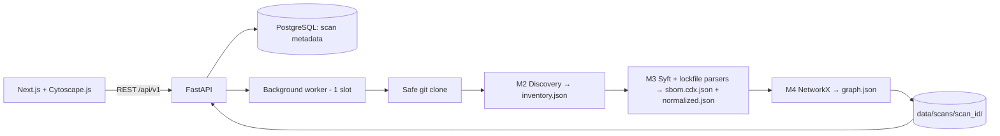

# Software Supply Chain Guardian: Work Summary (A to Z)

> Snapshot as of **23 November 2026**, at `main` commit `9ba00c5` (all five feature PRs merged).
> This summarizes what has been built. Contracts and rules are defined in [`README.md`](README.md),
> install steps are in [`SETUP.md`](SETUP.md), and each member's plan is in [`team_instructions/`](team_instructions/).

---

## A. The problem we are solving

Bosch / Amrita hackathon brief: build **agentic analysis of a software supply chain**, covering dependencies, vulnerabilities and suspicious changes. The brief lists five capabilities: *discover, detect, analyze, remediate, validate*.

- **Day 1 checkpoint:** a software inventory, a dependency graph, and vulnerability or suspicious-change evidence.
- **Day 2:** prioritization, approval, remediation, testing and a rescan.
- **Stretch:** reachability and provenance.
- **Hard rules from the brief:** don't attack production systems, don't use real credentials, don't publish malicious packages.

Tagline: *"Know What You Build. Trust What You Ship."*

## B. What we deliberately built first (Phase 1)

We started with a smaller first milestone, the **graph milestone**:

> Paste a public GitHub URL → clone it safely in isolation → find its project files → generate a CycloneDX SBOM with Syft → normalize packages and relationships, using only real evidence → build a NetworkX dependency graph → explore it interactively in Cytoscape.js.

Phase 1 is **not** the full Day 1 checkpoint. Vulnerability lookup and suspicious-change detection are still to do (see section W).

## C. Core principles that shape all of the code

1. **No fabricated facts.** No edge is inferred from package names, popularity or an LLM. A missing edge is reported as `unresolved` or `ambiguous`, and the scan is marked with `partial` and `warnings`.
2. **Never run code from the scanned repository.** There is no `npm install`, `pip install`, build step, hook or script execution. Syft only reads files.
3. **Public GitHub only.** HTTPS, exact `github.com` host, no credentials, no submodules.
4. **Stable, scan-independent IDs.** The same repository state always produces byte-identical node IDs, which makes later scan-to-scan diffs possible.
5. **Frozen, versioned contracts.** Every artifact carries `schema_version: "1.0"` and the API lives under `/api/v1`. Renaming a field requires a reviewed contract PR.
6. **Sanitized errors.** API responses never include tracebacks, host paths or secrets.

## D. Team and ownership

| # | Role | Branch | Owns | Main author (git) |
|---|---|---|---|---|
| M1 | Platform, ingestion, integration lead | `feature/ingestion` → `feature/ingestion-runtime` | FastAPI, DB, cloning, worker, schemas, root config | Ashwin |
| M2 | Repository discovery | `feature/repository-discovery` | `backend/app/discovery/` | Siri3005 |
| M3 | SBOM and dependency extraction | `feature/sbom-extraction` | `backend/app/sbom/` | Jahnavi7-dev |
| M4 | Dependency graph engine | `feature/graph-engine` | `backend/app/graph/` | kishore-learner |
| M5 | Frontend and graph visualization | `feature/frontend` | `frontend/` | Jayavandhini |

Each member owns their own `backend/tests/<module>/` folder and its fixtures. M1 is the only person who edits `pyproject.toml`, `app/schemas`, migrations, compose and env files.

## E. Timeline (git history)

| Order | Commit / PR | What landed |
|---|---|---|
| 1 | `bb9e84c` initial commit | Blueprint docs: README, SETUP, five member plans |
| 2 | `a4d67f4`, merged as PR #2 | **M1 bootstrap:** skeleton contracts, module stubs, compose/env, smoke tests |
| 3 | `4ab6b8b` → `a31b7f6` | **M3 SBOM** built in four steps: Syft runner and CycloneDX parser → stable IDs and npm lock resolver → Python parsers → Syft reconciliation and pipeline |
| 4 | `a9f19fe`, merged as PR #3 | **M2 discovery:** repository inventory |
| 5 | `86d5a5a`, merged as PR #4 | **M4 graph** generation module |
| 6 | `ce4ff3d`, merged as PR #5 | M3 refactored to use the shared `app.schemas` contracts |
| 7 | `7d86570`, merged as PR #6 | **M1 full scan runtime:** worker, DB lifecycle, API, recovery |
| 8 | `1a0d67d`, merged as PR #7 | **M5 frontend:** Next.js UI, polling, Cytoscape explorer |

All of this happened on 23 Nov 2026, following the planned integration order: bootstrap first, then independent modules, then wiring.

## F. Architecture at a glance



It is a modular monolith: one FastAPI process, PostgreSQL for scan status, and JSON artifacts on disk. Phase 1 deliberately has no Redis, Celery, Neo4j or LLM.

## G. Glossary

| Term | Meaning |
|---|---|
| **SBOM** | Software Bill of Materials: a list of the packages in a project |
| **CycloneDX** | A standard SBOM JSON format, produced here by Syft |
| **Syft** | Anchore's CLI that scans a directory and writes an SBOM without executing anything |
| **PURL** | Package URL, e.g. `pkg:npm/express@4.18.2` |
| **Root** | A project declaration such as a `package.json` or `pyproject.toml` |
| **Component** | One *instance* of a package at a specific install location |
| **Direct / transitive** | Depended on by a project root directly, or only through other packages |
| **Unresolved / ambiguous** | A declared dependency whose concrete target can't be proven from the evidence |

## H. The scan lifecycle

```
QUEUED → CLONING → DISCOVERING → GENERATING_SBOM → BUILDING_GRAPH → COMPLETED
                 (any non-terminal stage) ──────────────────────────→ FAILED
```

The worker ([`backend/app/ingestion/worker.py`](backend/app/ingestion/worker.py)) runs these stages in order. After each stage it validates the output with Pydantic, checks that the output's `scan_id` matches, writes the artifact atomically, and records the artifact path in the DB. Whatever happens, it deletes the cloned workspace when it finishes.

## I. Ingestion and platform (M1)

**API** ([`backend/app/api/routes/scans.py`](backend/app/api/routes/scans.py), [`main.py`](backend/app/main.py))

| Endpoint | Success | Notes |
|---|---|---|
| `GET /api/v1/health` | 200 | `{"status":"ok"}` |
| `POST /api/v1/scans` | 202 | Validates the URL and ref, reserves a worker slot (429 if busy), inserts a `QUEUED` row, schedules the background task |
| `GET /api/v1/scans/{id}` | 200 | Status, stage, repo, commit SHA, timestamps, warnings |
| `GET /api/v1/scans/{id}/inventory`, `/sbom`, `/graph` | 200 / 409 | 409 `ARTIFACT_NOT_READY` until that stage has finished |

Other error codes: 404 unknown scan, 422 bad URL, 503 DB down. CORS allows only the configured frontend origin, with GET and POST only.

**Security controls**

- **URL validation** ([`url_validation.py`](backend/app/ingestion/url_validation.py)): HTTPS only; exact `github.com`; no userinfo, port, query, fragment, `%`-encoding, backslashes or `//`; strict regexes for owner, repo and ref; rejects control characters.
- **Cloner** ([`cloner.py`](backend/app/ingestion/cloner.py)): runs `git` with `shell=False` and a minimal allow-listed environment. It also sets `GIT_TERMINAL_PROMPT=0`, uses an empty global git config, ignores the system config, skips LFS smudge, disables hooks, doesn't recurse into submodules and enforces a timeout. It records a verified 40-hex commit SHA.
- **Workspaces** ([`workspace.py`](backend/app/ingestion/workspace.py)): each scan gets its own directory. Scan IDs must match `scan_[0-9a-f]{32}`. Paths are checked so they can't escape their root. Size and file-count limits are enforced after the clone.
- **Capacity** ([`capacity.py`](backend/app/ingestion/capacity.py)): a semaphore enforces `MAX_ACTIVE_SCANS` (default 1).
- **Artifacts** ([`artifacts.py`](backend/app/ingestion/artifacts.py)): written to a temp file and then moved into place with `os.replace`. They are size-capped, re-validated when read back, and the raw CycloneDX file is integrity-checked.
- **Lazy module adapters** ([`interfaces.py`](backend/app/ingestion/interfaces.py)): if a module isn't installed, the scan fails cleanly with `PIPELINE_COMPONENT_UNAVAILABLE` instead of returning fake output.
- **Error mapping:** exceptions become safe codes such as `CLONE_TIMEOUT`, `CLONE_FAILED`, `REPOSITORY_LIMIT_EXCEEDED`, `INVALID_PIPELINE_OUTPUT` and `SCAN_FAILED`.
- **Restart recovery:** at startup the app marks any scans left in a non-terminal state as `FAILED`.

**Persistence:** PostgreSQL 16 runs in Docker Compose, bound to loopback only. There is a single `scans` table ([`models.py`](backend/app/database/models.py)) holding repo info, status, stage, artifact paths, warnings, error and timestamps. Alembic migration: `20261123_0001_create_scans`.

**Config** ([`config.py`](backend/app/config.py), [`.env.example`](.env.example)): DB URL, workspace and output roots (resolved from the project root), size, file and timeout limits, and the frontend origin.

## J. Repository discovery (M2)

[`backend/app/discovery/`](backend/app/discovery/) provides `discover_repository(repo_dir, scan_id) -> Inventory`.

- Walks the checkout **without reading or executing file contents**. Rejects a root that is a symlink or Windows junction, and skips `node_modules`, `.git` and similar directories.
- Classifies files using central rules ([`rules.py`](backend/app/discovery/rules.py)):
  - **Manifests and lockfiles** for npm, Python (requirements*, pyproject, setup.cfg, Pipfile, poetry/uv/Pipfile locks), Maven, Gradle, Go, Cargo, Bundler and Composer
  - **Languages**, by file extension
  - **Dockerfiles, CI workflows, IaC (`.tf`) and existing SBOMs**
- Outputs repo-relative POSIX paths. `file_count` counts the safe files actually visited. If a traversal limit is hit, it sets `partial=true` instead of pretending the inventory is complete.

## K. SBOM and dependency extraction (M3)

[`backend/app/sbom/`](backend/app/sbom/) provides `generate_dependency_document(repo_dir, inventory, scan_id, scan_dir) -> DependencyDocument`. This is the largest module.

| File | Job |
|---|---|
| `syft_runner.py` | Runs Syft safely: allow-listed env, timeout, output size cap, writes only `sbom.cdx.json` |
| `cyclonedx_parser.py` | Parses and validates the CycloneDX JSON, including components, locations and `dependencies[]` |
| `npm_lock.py` | Resolves npm `package-lock.json` **v2/v3**, using node_modules resolution to find real parent → child edges |
| `python_reqs.py` | Parses `requirements*.txt`, including nested `-r` includes; pins vs ranges |
| `python_project.py` | Parses `pyproject.toml` (PEP 621) and pairs it with Poetry or uv lockfiles |
| `poetry_lock.py`, `uv_lock.py` | Read locked Python relationships |
| `identities.py` | Deterministic SHA-256-based `root:` / `cmp:` / `rel:` IDs |
| `normalization.py` | Merges Syft components with lockfile and manifest records, then checks integrity |
| `records.py` | Internal records, evidence, safe-path normalization |
| `pipeline.py` | Orchestrates all of the above |

Rules M3 follows:

- **Lockfile edges are authoritative.** Syft's own `dependencies[]` are only used for packages that no lockfile describes.
- A Syft component is merged with a lockfile record only on a **strong identity match**: ecosystem + normalized name + exact version + the file Syft says it read. Multiple matches are enriched separately and never collapsed. Unmatched Syft components go into an `unknown-location` namespace.
- **Python without a lockfile gives direct declarations only, never invented transitive edges**, and a warning is added.
- Two copies of the same `name@version` at different install paths get **two different IDs**.
- Unsupported manifests (Maven, Go, etc.) and unpaired lockfiles produce explicit warnings rather than being silently ignored.

## L. Dependency graph engine (M4)

[`backend/app/graph/`](backend/app/graph/) provides `build_graph(document, app_name) -> GraphDocument`. It is a pure function with no filesystem, network or DB access.

- **`builder.py`:** builds a NetworkX `DiGraph`. The structure is application node `app:root` → `CONTAINS` → project roots → `DEPENDS_ON` → packages. Unresolved targets become `unresolved:<id>` placeholder nodes that carry their declared target and evidence.
- **`traversal.py`:** BFS shortest depth from the project roots, counting only `DEPENDS_ON` edges. A package is **direct** if any root points to it, **transitive** if a root reaches it by a longer path, and **unknown** otherwise.
- **`anomalies.py`:** finds cycles using strongly connected components, so it never hangs on a cycle. It also flags evidence paths that aren't repo-relative POSIX paths and marks the graph `partial` when it finds any.
- **`serialization.py`:** converts the graph into Cytoscape `{data:{...}}` elements with sorted, deterministic output and `meta.stats` (applications, projects, packages, unresolved, edges, max depth, cycles).
- **`filtering.py`:** returns the k-hop neighborhood subgraph around selected nodes, for focused views.

Golden fixtures cover chain, diamond, cycle, empty, multi-project, two-versions and unresolved graphs. For each one there is an expected `*.graph.json`, and the tests check the output byte for byte.

## M. Frontend (M5)

[`frontend/`](frontend/) is built with Next.js 15 (App Router), React 19, TypeScript, Tailwind v4, shadcn/ui, Axios, Cytoscape.js + dagre and Lucide.

- **`RepositoryForm`:** takes a GitHub URL and an optional ref, with client-side validation.
- **`useScan` hook:** polls `GET /scans/{id}` every 1.8 s on a single timer. On transient errors it backs off (up to 15 s) and stops after 5 failures. Once the scan finishes, it fetches inventory, SBOM and graph in parallel and ignores responses from an older scan.
- **`ScanProgress` / `RepositorySummary`:** stage stepper, commit SHA, warnings.
- **`ArtifactInventory` / `SbomSummary`:** what discovery and extraction found.
- **Graph explorer** (`GraphShell`, `GraphCanvas`, `GraphToolbar`, `PackageInspector`): Cytoscape loads client-side only, with a dagre layout. You can search, filter by directness (direct, transitive, unresolved) and by ecosystem (npm, pypi, other). Graphs over 400 nodes are trimmed to a neighborhood view. Clicking a node opens an inspector with its evidence. Unresolved edges are drawn dashed.
- **`lib/graph.ts`:** pure helpers for search, filtering, limiting and payload validation.
- **Offline mode:** set `NEXT_PUBLIC_USE_MOCKS=true` to use synthetic fixtures from `src/mocks/`. The UI then shows a "Sample data (offline)" badge, and real API errors never silently fall back to mocks.
- **Types:** `src/types/` mirrors the v1.0 contracts.

## N. Shared data contracts (`backend/app/schemas/`)

| Artifact | Producer → consumer | Model |
|---|---|---|
| Scan state | M1 → M5 | `schemas/scan.py` |
| `inventory.json` | M2 → M3 | `schemas/inventory.py` |
| `normalized.json` | M3 → M4 (also served at `/sbom`) | `schemas/dependency.py` |
| `graph.json` | M4 → M5 | `schemas/graph.py` |
| Error body | M1 → M5 | `schemas/error.py` |

Edge direction everywhere: `from_id` **depends on** `to_id`.

## O. On-disk output per scan

```
data/                        (gitignored, never committed)
├── workspaces/<scan_id>/repo/   ← temporary clone, deleted after the scan
└── scans/<scan_id>/
    ├── inventory.json
    ├── sbom.cdx.json            ← raw Syft CycloneDX
    ├── normalized.json
    └── graph.json
```

## P. Testing

| Area | Test functions | What they cover |
|---|---:|---|
| `backend/tests/ingestion` | 30 | API codes, URL attack cases, cloner env, workspace limits, capacity, artifacts, DB, worker, contract fixtures |
| `backend/tests/discovery` | 11 | Fixture repos (npm, Python reqs/uv, multi-project, strange paths), security limits |
| `backend/tests/sbom` | 101 | CycloneDX, identities, npm v2/v3/duplicate/ambiguity, requirements, Poetry/uv, Syft runner, full pipeline handoff |
| `backend/tests/graph` | 54 | Builder, cycles, depth, identity, queries, serialization, unresolved; golden JSON |
| `frontend/src/test` | 30 | Form validation, error mapping, graph helpers, `useScan` polling, `GraphShell` |

Counts are the number of test functions/cases in source, not the results of a run.

**CI** ([`.github/workflows/backend.yml`](.github/workflows/backend.yml)): runs on PRs and on pushes to `main` that touch `backend/`. It uses Python 3.12 and runs `ruff check` and `pytest`. There is no frontend CI workflow yet.

## Q. How to run it locally (short version)

Follow [`SETUP.md`](SETUP.md) for full Windows and macOS instructions. On macOS:

```bash
cp .env.example .env && docker compose up -d postgres
```

```bash
cd backend && python3.12 -m venv .venv && .venv/bin/pip install -e '.[dev]' && .venv/bin/python -m alembic upgrade head && .venv/bin/python -m uvicorn app.main:app --reload --port 8000
```

```bash
cd frontend && npm ci && cp .env.local.example .env.local && npm run dev
```

Prerequisites: Git, Python 3.12, Node LTS, Docker Desktop, and Syft (`brew install syft` / `winget install Anchore.syft`).

## R. Repository layout (as built)

```
.
├── README.md, SETUP.md, WORK_SUMMARY.md
├── team_instructions/0{1..5}_*.md
├── docker-compose.yml, .env.example, .github/workflows/backend.yml
├── backend/
│   ├── pyproject.toml, alembic.ini, migrations/
│   ├── app/{main.py, config.py, api/, database/, ingestion/, schemas/, discovery/, sbom/, graph/}
│   └── tests/{ingestion, discovery, sbom, graph}/
└── frontend/src/{app, components, hooks, lib, services, types, mocks, test}/
```

## S. Security posture summary

| Threat | Mitigation |
|---|---|
| Malicious URL (SSRF, local host, credentials, encoding tricks) | Strict URL validator, `github.com` only |
| Shell injection | `subprocess` with argument lists, `shell=False` |
| Running repo code | No installs or builds; git hooks disabled; Syft reads files only |
| Credential leakage | Minimal env allow-list; empty git config; no prompts |
| Path traversal / symlinks | Per-scan roots, `relative_to` checks, symlink and junction rejection, POSIX evidence validation |
| Resource exhaustion | Clone and Syft timeouts, repo size and file-count caps, artifact size caps, 1 active scan |
| Information leakage | Sanitized error codes; no tracebacks or paths in responses |

**Known limitation:** `MAX_REPOSITORY_SIZE_MB` is checked *after* the clone, so we don't claim full DoS resistance.

## T. Supported ecosystems

| Ecosystem | Discovery | Dependency extraction |
|---|---|---|
| npm | ✅ | ✅ Full edges from `package-lock.json` v2/v3 |
| Python + Poetry / uv | ✅ | ✅ Locked relationships |
| Python requirements / bare pyproject | ✅ | ⚠️ Direct declarations only (warning added) |
| Maven, Gradle, Go, Cargo, Bundler, Composer | ✅ Detected | ❌ Warning: "not supported yet". Packages may still appear via Syft |

## U. Honesty guardrails in the output

- `partial: true` together with `warnings[]` at every layer: inventory, normalized document, graph and scan.
- Unresolved and ambiguous edges are never guessed. They show up as dashed placeholder nodes along with the evidence explaining why.
- The scan lifecycle never claims vulnerability scanning happened.
- Mock data in the UI is always labelled.

## V. Current status

- ✅ All five Phase 1 modules are implemented and merged into `main`.
- ✅ The worker is wired end to end: clone → discovery → SBOM → graph.
- ⚠️ The status line at the top of `README.md` still says "until M2–M4 land", which is now out of date.
- ⚠️ This summary was written from reading the code. I didn't run the test suites, and the repository doesn't record a live end-to-end scan against a real public GitHub repo. The README's stated next action is still to run one authorized end-to-end scan before using the live UI.
- ⚠️ There is no CI for the frontend yet.

## W. What comes next

**Phase 1B (to meet the Bosch Day 1 checkpoint)**

- Integrate one vulnerability source (e.g. OSV) against the normalized components.
- Add at least one evidence-backed non-CVE detector, such as a changed lockfile, an unpinned or unsafe GitHub Action, or a suspicious install script.
- For each finding, show the source evidence, the dependency path, and how certain it is.

**Phase 2 (Bosch Day 2)**

- Explainable, rule-assisted prioritization.
- Proposed fixes that require human approval.
- Sandbox validation followed by a before/after rescan, with an audit trail.

**Stretch**

- **Supply Chain Change Intelligence:** diff graph IDs and edges between commits. The stable IDs are designed to make this possible.
- **Trust Lineage:** repo → commit → workflow → SBOM → artifact → image → app.
- Any LLM added later should only *interpret* verified evidence, never create facts.

## X. Explicitly out of scope for the MVP

Redis, Celery, Kafka, Neo4j, containers for running scanned code, Grype, Trivy, Cosign, Semgrep, LLMs, private repositories, submodules, arbitrary SHAs as refs, automated PR merges and production deployments.

## Y. Collaboration rules we followed

- Feature branches → small PRs → one approval and green checks → merge. No direct pushes to `main`.
- Conventional commits, e.g. `feat(sbom): ...`, `refactor(sbom): ...`.
- Contract-first: modules were built against frozen JSON examples and fixtures, so nobody was blocked waiting on another member.

## Z. In one paragraph

In one day the five-person team turned the blueprint into a working Phase 1 pipeline, all merged into `main`. A user submits a public GitHub URL to a FastAPI service. A sandboxed git clone feeds a read-only discovery engine, which produces an inventory of manifests and lockfiles. Syft plus dedicated npm and Python lockfile parsers turn that into an evidence-backed normalized dependency document with stable, location-aware IDs. A pure NetworkX engine turns the document into a deterministic Cytoscape graph that includes depth, directness, cycle and unresolved-dependency information. A Next.js UI polls the scan and lets the user explore and inspect that graph. The design never fabricates relationships and never runs scanned code. The next step is to add vulnerability and suspicious-change evidence to meet the Bosch Day 1 checkpoint.
