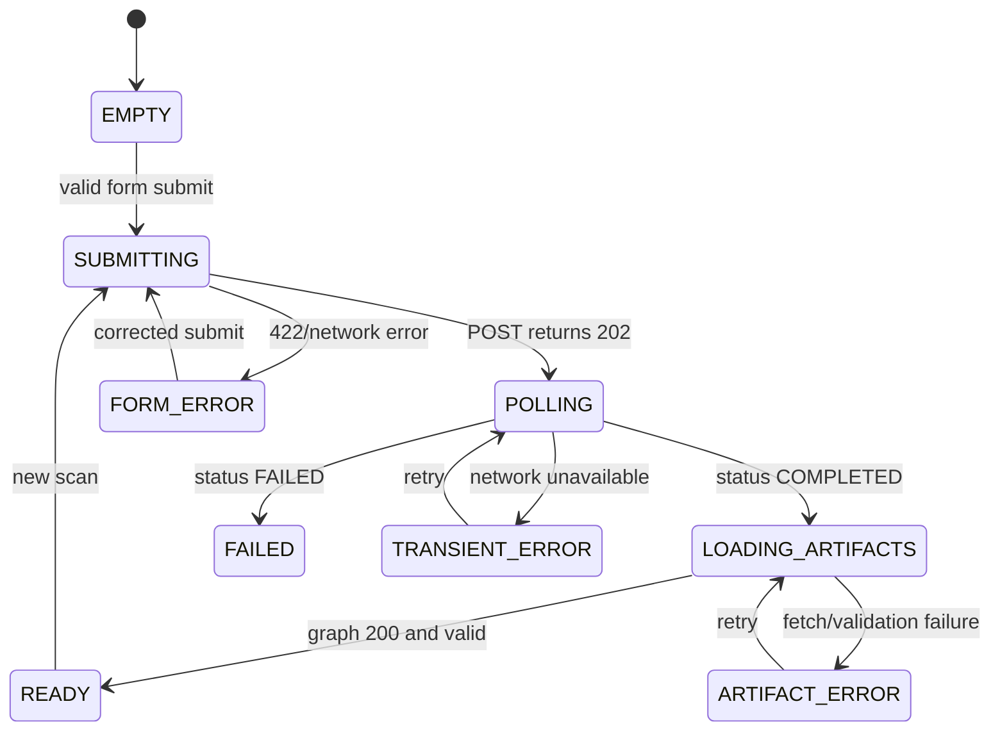

# Member 5 — Next.js Frontend and Interactive Dependency Graph

**Branch:** `feature/frontend` · **Review:** Member 4 (M1 reviews API integration) · **Primary outcome:** a visually polished, truthful, responsive application that accepts a public GitHub URL, polls scan progress and renders searchable/selectable dependency nodes from Cytoscape-compatible JSON.

> **You can build the whole frontend against mock JSON before FastAPI/Syft/NetworkX exist.** All API shapes, statuses and graph semantics are fixed by [`README.md`](../README.md); OS-specific installation is in [`SETUP.md`](../SETUP.md). Do **not** generate alternate backend contracts.

## Ownership and scope

**You exclusively own all of `frontend/**`**, including `package.json`, `package-lock.json`, `components.json`, `src/app/**`, CSS and frontend mocks/tests. Do not edit any `backend/**`, database, Compose, root env or shared schema files. Any needed backend field must be proposed to M1/M4 as a reviewed contract change.

Suggested structure:

```text
frontend/
├── package.json / package-lock.json
├── components.json
├── .env.local.example
├── vitest.config.ts
└── src/
    ├── app/{layout.tsx,page.tsx,globals.css}
    ├── components/
    │   ├── scan/{RepositoryForm.tsx,ScanProgress.tsx,RepositorySummary.tsx}
    │   ├── graph/{GraphShell.tsx,GraphCanvas.tsx,GraphToolbar.tsx,PackageInspector.tsx}
    │   ├── inventory/{ArtifactInventory.tsx,SbomSummary.tsx}
    │   └── ui/                         # shadcn-owned generated components
    ├── hooks/{useScan.ts,useGraphFilter.ts}
    ├── services/{api.ts,mockApi.ts}
    ├── types/{api.ts,graph.ts}
    ├── mocks/{scan.json,inventory.json,sbom.json,graph.json}
    └── test/{setup.ts,RepositoryForm.test.tsx,GraphShell.test.tsx,useScan.test.ts}
```

**Milestone UI:** URL + optional branch/tag → submit → progress → metadata/languages/manifests → graph → search/select → package evidence. No fabricated vulnerability badges, risk scores, CVEs or AI recommendations. A mock display must visibly state **Sample data** until live API integration.

## Step 1 — Bootstrap Next.js once, on your feature branch

From repo root, **only you** run:

```bash
npx create-next-app@latest frontend --typescript --tailwind --eslint --app --src-dir --use-npm --import-alias "@/*"
cd frontend
npm install axios cytoscape cytoscape-dagre lucide-react
npm install --save-dev @types/cytoscape @types/cytoscape-dagre vitest jsdom @testing-library/react @testing-library/jest-dom
npx shadcn@latest init
npx shadcn@latest add button card input badge skeleton sheet separator
```

On both Windows PowerShell and macOS, commands work in terminals with Node.js LTS and npm installed. After setup, **teammates use `npm ci`**, not `create-next-app`. Commit `package-lock.json`. In `package.json`, add scripts: `"lint":"eslint ."`, `"typecheck":"tsc --noEmit"`, `"test":"vitest run"`, alongside Next's `dev`, `build`, `start`.

Copy `frontend/.env.local.example` → `frontend/.env.local` (copy instructions by OS in `SETUP.md`). Use:

```dotenv
NEXT_PUBLIC_API_BASE_URL=http://127.0.0.1:8000/api/v1
# Optional local-only sample mode for developing without backend:
NEXT_PUBLIC_USE_MOCKS=true
```

The committed `.env.local.example` contains `NEXT_PUBLIC_API_BASE_URL` only; the mock flag goes into **your local ignored** `.env.local` or an explicitly documented nonproduction sample mode. Never put secrets in `NEXT_PUBLIC_*`; values are visible in the browser bundle. On live integration set `NEXT_PUBLIC_USE_MOCKS=false` and restart Next.js.

## Step 2 — Design the dashboard before backend exists

Suggested layout (responsive):

```text
┌────────────────────────────────────────────────────────────────┐
│ Software Supply Chain Guardian                         [About] │
│ Know what you build. Trust what you ship.                      │
├────────────────────────────────────────────────────────────────┤
│ GitHub repository URL  [https://github.com/owner/repo      ]   │
│ Branch/tag (optional) [main                   ] [Scan repo]     │
├────────────────────────────────────────────────────────────────┤
│ Scan stage: DISCOVERING ...   SHA: 0123456   Warnings: 1      │
├────────────────────────────────────────────────────────────────┤
│ Packages: 84  Projects: 2  Edges: 103  Unresolved: 6           │
├───────────────┬────────────────────────────┬───────────────────┤
│ Artifacts     │ Graph: zoom/pan, layout   │ Package details   │
│ Languages     │      ○──○──○              │ name, version     │
│ Manifests     │       \  /                 │ PURL, scope       │
│ Lockfiles     │        ○──○                │ source evidence   │
│ Docker/CI/IaC │ Search + Filters          │ dependency depth  │
└───────────────┴────────────────────────────┴───────────────────┘
```

**Design system:** responsive Tailwind `grid` (`lg:grid-cols-[240px_minmax(0,1fr)_300px]`), shadcn cards/buttons/input/skeleton, Lucide icons, consistent neutral UI with accent for current scan stage. On mobile stack panels; replace inspector sidebar with a drawer/sheet. Use accessible labels and keyboard focus, not color alone to encode package status. Visually differentiate **project**, **package**, **unresolved** and **application**; the palette should not imply risk severity.

**User-visible limitations:** When `partial=true`, show `Incomplete dependency evidence` and the list of `warnings`. If there is a package with unknown version, display `Version not resolved`, not `safe` or `latest`. If there are no packages, state `No supported dependencies discovered` rather than `No risks found`.

## Step 3 — Type the API contract exactly

Create `src/types/api.ts`:

```typescript
export type ScanStatus =
  | "QUEUED" | "CLONING" | "DISCOVERING" | "GENERATING_SBOM"
  | "BUILDING_GRAPH" | "COMPLETED" | "FAILED";

export interface ScanCreate {
  repository_url: string;
  ref?: string | null;
}
export interface ScanCreated {
  scan_id: string;
  status: "QUEUED";
  repository_name: string;
}
export interface ScanState {
  schema_version: "1.0";
  scan_id: string;
  status: ScanStatus;
  current_stage: ScanStatus | null;
  repository: {
    url: string; owner: string; name: string;
    requested_ref: string | null; resolved_ref: string | null;
    commit_sha: string | null;
  };
  created_at: string;
  started_at: string | null;
  finished_at: string | null;
  error: string | null;
  warnings: string[];
}
export interface ArtifactEntry {
  path: string; kind: string; ecosystem: string;
}
export interface Inventory {
  schema_version: "1.0"; scan_id: string;
  languages: Array<{ name: string; file_count: number }>;
  manifests: ArtifactEntry[]; lockfiles: ArtifactEntry[];
  dockerfiles: string[]; ci_files: string[]; iac_files: string[];
  existing_sboms: string[]; source_directories: string[];
  file_count: number; partial: boolean; warnings: string[];
}
export interface ApiError {
  error: { code: string; message: string; details: Record<string, unknown> };
  scan_id: string | null;
}
```

Create `src/types/graph.ts`:

```typescript
export type NodeKind = "application" | "project" | "package" | "unresolved";
export type Directness = "direct" | "transitive" | "unknown" | "not_applicable";
export interface Evidence { path: string; kind: string; locator: string }
export interface GraphNodeData {
  id: string; label: string; type: NodeKind; directness: Directness;
  depth: number | null;
  name?: string; version?: string | null; ecosystem?: string;
  purl?: string | null; project_path?: string; install_path?: string | null;
  evidence?: Evidence[];
  // optional unresolved target metadata; do not assume a package was resolved
  unresolved_target?: { name: string; specifier: string; ecosystem: string };
  resolution_status?: "unresolved" | "ambiguous";
}
export interface GraphEdgeData {
  id: string; source: string; target: string;
  type: "CONTAINS" | "DEPENDS_ON";
  resolution_status?: "resolved" | "unresolved" | "ambiguous";
  evidence?: Evidence[];
}
export interface GraphDocument {
  meta: {
    schema_version: "1.0"; scan_id: string; partial: boolean;
    stats: { applications: number; projects: number; packages: number;
             unresolved: number; depends_on_edges: number;
             max_depth: number; cycles: number };
    warnings: string[];
  };
  nodes: Array<{ data: GraphNodeData }>;
  edges: Array<{ data: GraphEdgeData }>;
}
```

For `src/types/sbom.ts`, mirror the README's `DependencyDocument` precisely: root fields, component instance fields, nullable version/PURL, relationships with null `to_id` and `unresolved_target`, evidence and `partial/warnings`. **`GET /sbom` returns normalized JSON**, not the raw CycloneDX artifact.

## Step 4 — API client and mock adapter

Create `src/services/api.ts` with a single base URL from environment. Do not embed local absolute paths or Git credentials:

```typescript
import axios from "axios";
import type { ScanCreate, ScanCreated, ScanState, Inventory } from "@/types/api";
import type { GraphDocument } from "@/types/graph";

const client = axios.create({
  baseURL: process.env.NEXT_PUBLIC_API_BASE_URL ?? "http://127.0.0.1:8000/api/v1",
  timeout: 15_000,
});

export const api = {
  createScan: async (body: ScanCreate): Promise<ScanCreated> =>
    (await client.post<ScanCreated>("/scans", body)).data,
  getScan: async (id: string): Promise<ScanState> =>
    (await client.get<ScanState>(`/scans/${encodeURIComponent(id)}`)).data,
  getInventory: async (id: string): Promise<Inventory> =>
    (await client.get<Inventory>(`/scans/${encodeURIComponent(id)}/inventory`)).data,
  getSbom: async (id: string) =>
    (await client.get(`/scans/${encodeURIComponent(id)}/sbom`)).data,
  getGraph: async (id: string): Promise<GraphDocument> =>
    (await client.get<GraphDocument>(`/scans/${encodeURIComponent(id)}/graph`)).data,
};
```

Use `src/services/mockApi.ts` with the **same method signatures** returning static JSON fixtures; do not mix production/mock branches inside UI components. In `src/services/scanService.ts` (or API factory), choose `mockApi` only when `NEXT_PUBLIC_USE_MOCKS==='true'`; visibly label the app `Sample data (offline)` in that mode. Mock states should progress in deterministic test sequences rather than random delays. Once M1 merges OpenAPI, compare every JSON field and status code, and remove any backend-invented assumptions.

Error behavior:

| Response | UI action |
|---|---|
| 202 POST | store `scan_id`, begin status polling |
| 200 status nonterminal | show current stage and repository details when available |
| 200 COMPLETED | fetch inventory, normalized SBOM and graph; render |
| 200 FAILED | stop polling, show sanitized `error` and a resubmit option |
| 409 artifact | preserve progress; show `Not ready` rather than error toast storm |
| 404 scan | stop polling, tell user scan ID was not found |
| 422 URL/ref | show validation message at input; do not retry automatically |
| 429 rate limit | tell user scanner is busy; no automatic retry storm |
| 503/network timeout | show retry/status check action; don't falsely report FAILED |

## Step 5 — Repository form with basic client validation

Create `RepositoryForm.tsx` as a controlled client component with URL, optional ref, submit, disabled-while-submitting and inline errors. Client validation is **for usability only**; M1 repeats strict security validation on the server. Allow `https://github.com/owner/repo` and optional `.git`; do not normalize URLs into SSH or attach auth tokens. Optional `ref` should be sent as `null` if blank, since M1 uses the default remote branch. Press Enter to submit; label fields and announce errors for assistive technology.

Example handler:

```tsx
async function onSubmit() {
  setSubmitError(null);
  const url = repositoryUrl.trim();
  if (!/^https:\/\/github\.com\/[A-Za-z0-9-]+\/[A-Za-z0-9._-]+(?:\.git)?$/.test(url)) {
    setSubmitError("Enter a public GitHub URL such as https://github.com/owner/repo");
    return;
  }
  try {
    const created = await scanService.createScan({ repository_url: url, ref: ref.trim() || null });
    setScanId(created.scan_id);
  } catch (error) {
    setSubmitError(getFriendlyError(error));
  }
}
```

Keep `getFriendlyError` centralized. Reject client-invalid input, but only backend confirmation can determine if a repo is actually public or a ref exists. Handle 202 without waiting for the scan to finish inside a POST call.

## Step 6 — Poll scan status without overlapping requests

Implement `useScan(scanId)` with an `AbortController`, a single scheduled timer and cleanup on ID change/unmount. Poll about every **1.5–2 seconds** in the hackathon demo; no busy loop. Stop when `COMPLETED` or `FAILED`. Avoid duplicate requests in React Strict Mode; ignore stale responses when user submits a new scan. `current_stage` while `QUEUED` is null; only display `Generating SBOM` during `GENERATING_SBOM` and `Graph ready` after graph fetch success.

Pseudo-hook:

```typescript
useEffect(() => {
  if (!scanId) return;
  let stopped = false;
  let timer: ReturnType<typeof setTimeout> | undefined;
  const tick = async () => {
    try {
      const state = await scanService.getScan(scanId);
      if (stopped) return;
      setScan(state);
      if (state.status === "COMPLETED" || state.status === "FAILED") return;
    } catch (err) {
      if (stopped) return;
      setTransientError(getFriendlyError(err));
    }
    if (!stopped) timer = setTimeout(tick, 1800);
  };
  void tick();
  return () => { stopped = true; if (timer) clearTimeout(timer); };
}, [scanId]);
```

Add cancellation for real network I/O when feasible; a simple closure guard prevents stale state updates but doesn't actually cancel an in-flight HTTP request. For a network outage, use capped backoff/explicit retry rather than hammering API. When `COMPLETED`, fetch inventory/graph in parallel; a failed graph fetch should show a retry button and not be replaced by invented sample graph. If M1 returns partial data, display it with warnings.

## Step 7 — Cytoscape client-only component

The graph is a browser visualization, **not a server-rendered Next.js component**. Use a client wrapper with a dynamic import:

```tsx
// src/components/graph/GraphShell.tsx
"use client";
import dynamic from "next/dynamic";
const GraphCanvas = dynamic(() => import("./GraphCanvas"), { ssr: false });
export default function GraphShell({ graph }: { graph: GraphDocument }) {
  return <GraphCanvas graph={graph} />;
}
```

`GraphCanvas.tsx`: `"use client"`; inside `useEffect` dynamically import `cytoscape` and `cytoscape-dagre`, register `cytoscape.use(dagre)`, then initialize into a `ref` div with fixed/min height (e.g., `min-h-[480px]`). Destroy instance on unmount/graph ID change. Use `graph.nodes.concat(graph.edges)` as elements, **not** a custom nodes/links transformation. Store the Cytoscape instance in a `useRef`, not React state, to avoid unnecessary re-renders.

```tsx
useEffect(() => {
  let alive = true;
  let current: import("cytoscape").Core | undefined;
  (async () => {
    const cytoscape = (await import("cytoscape")).default;
    const dagre = (await import("cytoscape-dagre")).default;
    cytoscape.use(dagre);
    if (!alive || !container.current) return;
    current = cytoscape({
      container: container.current,
      elements: [...graph.nodes, ...graph.edges],
      layout: { name: "dagre", rankDir: "LR", nodeSep: 45, rankSep: 85 },
      style: graphStyles,
      wheelSensitivity: 0.15,
    });
    current.on("tap", "node", (event) => setSelectedId(event.target.id()));
  })();
  return () => { alive = false; current?.destroy(); };
}, [graph]);
```

`graphStyles` is **your** `cytoscape.Stylesheet[]` to implement. Use selectors like `node[type = "application"]`, `node[type = "project"]`, `node[type = "package"]`, `node[type = "unresolved"]`, `node[directness = "direct"]`, `edge[type = "DEPENDS_ON"]`, `edge[resolution_status = "unresolved"]`. Direction should be `source → target` with arrowheads; `CONTAINS` edges have a visually different color/line style. Dashed unresolved edges communicate **uncertainty**, not vulnerability. For package labels show `name` or `name@version` if known; do not show blank `@undefined`. Add `fit`, center on selected, zoom +/- and reset layout controls.

### Graph filters/search (minimum)

- Search by package **name**, PURL and version, case-insensitive, show matching count. Selecting a search result should focus/zoom on that node and open inspector.
- Filter `All / Direct / Transitive / Unresolved` without changing original payload. Keep app/project roots or show filtered-context banner. Build visible edges **only if both endpoints are visible**; no accidental dangling edge after filtering.
- Optional ecosystem toggles `npm / pypi / other`; show counts and a note when filters hide nodes.
- Prevent a graph containing 5,000 elements from freezing the page: for large graphs initially display a root neighborhood/selected package neighborhood, clearly state `Showing X of Y nodes` and allow expanding the view. Never claim the unseen nodes are absent.
- Clicking a package opens a sidebar with name, version (or unknown), PURL, ecosystem, directness, shortest dependency depth, project/install path if known, evidence list. For unresolved nodes, show requested name/specifier and why unresolved. A node without evidence must show `Evidence unavailable` and be flagged for backend contract review.
- Show a visible `Incomplete dependency data` notice if `graph.meta.partial` is true or `graph.meta.warnings` nonempty.

## Step 8 — Summary widgets and artifact inventory

`RepositorySummary.tsx` reads only `ScanState.repository`, displays canonical repo URL, requested/resolved ref (when available), **short commit SHA** while preserving full value in tooltip, and stage timestamps. `ArtifactInventory.tsx` reads `Inventory` arrays: languages, manifests, locks, Dockerfiles, CI and IaC with repo-relative paths. `SbomSummary.tsx` reads normalized `/sbom` components/roots/relationships; use graph `meta.stats` for graph counts, not independently guessed totals. Explain that `packages` means **discovered package instances**, not CVEs or severity. If component array has unknown directness, show it as such. `partial` warning should be visible even with a successful HTTP 200.

### UI state machine



`READY` requires a valid graph payload. Do not silently fall back to sample/mock data on any real API failure; that's misleading in a security product.

## Step 9 — Unit/UI tests (without backend)

Configure `vitest.config.ts` with a `jsdom` test environment and a `setupFiles` importing `@testing-library/jest-dom/vitest`. Mock `scanService` methods at the service boundary. Avoid trying to run actual Cytoscape canvas layout under jsdom for every unit test; test data filtering/search and inspector in pure functions + components, then perform one **manual browser** integration test with real Cytoscape.

| Test | Expected |
|---|---|
| Form valid/invalid URL | valid submits typed `ScanCreate`; invalid shows accessible error |
| Optional ref | blank serializes as `null`; valid `main` preserved |
| Polling | stops on COMPLETED/FAILED, stale scan cleared, no overlapping loop |
| API responses | 404/409/422/429/503 mapped to distinct UI messages |
| Graph fixture | all expected node/edge IDs present and typed |
| Search | case-insensitive name/PURL/version with deterministic results |
| Filters | direct/transitive/unresolved views; no edge references hidden nodes |
| Inspector | version, install path, PURL, evidence displayed; unknown is explicit |
| Empty graph | useful empty state, no uncaught error |
| Partial graph | user-visible warnings and unresolved counts |
| Responsive | mobile sheet usable; sidebar and graph not clipped |
| Manual real API | POST→poll→graph and click node in browser |

```bash
# from frontend/ (both OS)
npm ci
npm run lint
npm run typecheck
npm run test
npm run build
npm run dev
```

In tests, start with `src/mocks/scan.json`, `inventory.json`, `sbom.json`, `graph.json` matching README v1.0. Populate graphs with **synthetic labelled sample packages** and show mock mode prominently; do not misrepresent these as a repository's detected vulnerabilities.

## Parallel Development and Collaboration

**Start immediately:** create Next.js app, typed API models, scan form, dashboard, mocked scan lifecycle, graph renderer, filtering/search/inspector, error/empty states and UI tests. No need to wait for Git, database, backend or graph engine. Build/test entirely with `src/mocks/` and one sample normalized/graph JSON from README; ensure `NEXT_PUBLIC_USE_MOCKS=true` clearly identifies offline demonstration.

| Member | What you need | Workaround until ready | Integration gate |
|---|---|---|---|
| M1 | POST 202, GET status/inventory/sbom/graph, CORS | mock `scanService`; `http://localhost:8000` not required | live API matches exact status and fields |
| M4 | Cytoscape `nodes`, `edges`, graph stats | commit `src/mocks/graph.json` from canonical example | M4 golden graph renders with zero transforms |
| M3 | normalized `/sbom` for component counts | use canonical normalized fixture | unknown/purl/null fields handled |
| M2 | inventory array shape | use canonical inventory fixture | repository file paths render safely |

**Must not modify:** any backend, M1-owned schema/docs/Compose, other members' tests or shared Python dependencies. **PR review:** M4 primary; M1 for live API integration. **PR sequence:** scaffold/design/UI mocks; graph visualization and inspector; scan form/polling/API adapter; live integration, responsiveness and regression tests. **Integration blockers:** JSON field mismatch, incorrect edge ID/direction, CORS, browser SSR errors, graph huge/slow, undefined version/paths, absent evidence. Continue with mocks while opening a small issue with payload/reproduction; **never make up data or alter backend JSON in your branch**. If a contract must change, M1 + producer and consumer review it before implementation.

## Acceptance checklist

- [ ] `frontend/` scaffold, scripts and lockfile work on Windows/macOS with `npm ci`.
- [ ] Form accepts a valid public GitHub URL/optional ref, submits exactly `ScanCreate`, shows backend errors.
- [ ] Status polling handles `QUEUED` to terminal `COMPLETED`/`FAILED` without excessive requests.
- [ ] Inventory and normalized SBOM shown, including warnings and unknown relationship coverage.
- [ ] Cytoscape graph shows app/projects/packages/unresolved nodes, directed arrows, correct evidence.
- [ ] Search, selection/inspector, filters, pan, zoom and reset layout function.
- [ ] Responsive and keyboard-accessible; empty/error/partial states are understandable.
- [ ] Mock mode visible and never substituted for real scan without user's knowledge.
- [ ] Real endpoint integration succeeds after M1/M3/M4 merges, without schema forks.
- [ ] All tests/build pass; only `frontend/**` changed in reviewed PR.

**Handoff:** publish an early working screenshot/demo of **mock-labelled** graph, list the exact graph JSON fixture used, and share any contract gaps with M1+M4. Final joint demo must use a **real** scan output, not fixture mode.
