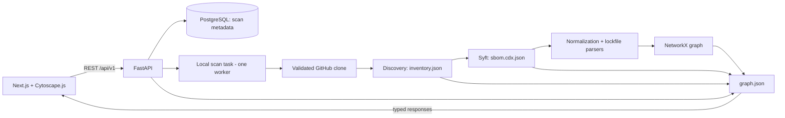
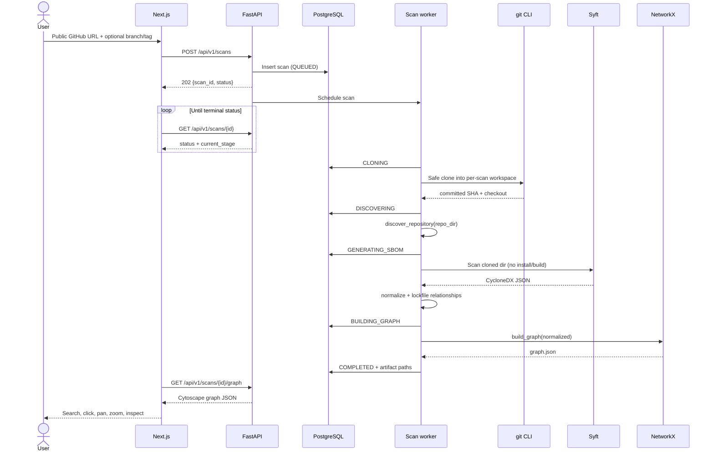

# Software Supply Chain Guardian

> **Know What You Build. Trust What You Ship.**  
> Bosch / Amrita hackathon · implementation blueprint v1.0 · 23 November 2026

**Status:** the M1 platform runtime is implemented: PostgreSQL-backed scan lifecycle, secure GitHub ingestion, guarded workspaces, typed orchestration, atomic artifacts, versioned API endpoints and restart recovery. M2-M5 implementations are developed and merged independently; until M2-M4 land, a real submission safely fails at the first unavailable module instead of claiming completion. **Do not interpret an illustrative JSON payload as a successful scan.**

## Start here

This is the **single authoritative README** for the five-person team. Read this file, then [`SETUP.md`](SETUP.md), then your assigned member plan. Changes to public API contracts, field names, path layout or shared dependencies require a reviewed contract PR before consumers change.

| Role | Plan | Branch | Module owned |
|---|---|---|---|
| 1 · Platform/ingestion/integration lead | [`01_MEMBER_1_PLATFORM_AND_INGESTION.md`](team_instructions/01_MEMBER_1_PLATFORM_AND_INGESTION.md) | `feature/ingestion` | FastAPI, scan lifecycle, cloning, persistence, integration |
| 2 · Repository discovery | [`02_MEMBER_2_REPOSITORY_DISCOVERY.md`](team_instructions/02_MEMBER_2_REPOSITORY_DISCOVERY.md) | `feature/repository-discovery` | repo inventory, languages, manifests, CI and IaC |
| 3 · SBOM/dependency extraction | [`03_MEMBER_3_SBOM_AND_DEPENDENCY_EXTRACTION.md`](team_instructions/03_MEMBER_3_SBOM_AND_DEPENDENCY_EXTRACTION.md) | `feature/sbom-extraction` | Syft, CycloneDX, npm/Python parsers, normalization |
| 4 · Dependency graph engine | [`04_MEMBER_4_DEPENDENCY_GRAPH_ENGINE.md`](team_instructions/04_MEMBER_4_DEPENDENCY_GRAPH_ENGINE.md) | `feature/graph-engine` | NetworkX, graph metrics and Cytoscape export |
| 5 · Frontend | [`05_MEMBER_5_FRONTEND_AND_GRAPH_VISUALIZATION.md`](team_instructions/05_MEMBER_5_FRONTEND_AND_GRAPH_VISUALIZATION.md) | `feature/frontend` | Next.js UI, polling, Cytoscape, graph exploration |

## Bosch brief: what we are actually building

**Source:** `Amrita_BD Hackathon_Problem_Statement (1).pdf` (six-slide Bosch document, dated 6 October 2026). Page 2 calls for agentic analysis of dependencies, vulnerabilities and suspicious changes, with five capabilities: discover, detect, analyze, remediate, validate. Page 3 explicitly rules out attacking production systems, using real access credentials, or publishing malicious packages. Page 4's **Day 1 checkpoint** requires a software inventory, dependency graph **plus vulnerability/suspicious-change evidence**; page 5's **Day 2** covers prioritization, approval, remediation, testing, rescan. Page 6 describes stretch goals such as reachability and provenance.

### Deliberately smaller first milestone

**Phase 1 acceptance demo:** paste a permitted public GitHub repository URL → isolate and clone → discover project artifacts → generate CycloneDX SBOM with Syft → normalize real package/relationship evidence → construct NetworkX directed graph → inspect graph interactively in Cytoscape.js.

**Phase 1 is NOT the full Bosch Day 1 checkpoint.** Its output provides the foundation. Immediately afterward, add a narrowly scoped vulnerability lookup and one evidence-backed suspicious-change detector to satisfy Day 1; defer AI prioritization, remediation, test-and-rescan to Phase 2. Never demonstrate unimplemented detection as real.

**Guardrails:** public GitHub only (MVP), explicitly authorized targets, local/sandbox execution, no secrets, no installs or builds of submitted repositories, no user-supplied scripts, no submodule recursion, no automated PR merges or production deployments.

## MVP architecture





## Technology decisions

| Area | Chosen | Why / scope boundary |
|---|---|---|
| Frontend | Next.js App Router, React, TypeScript, Tailwind, shadcn/ui, Axios, Cytoscape.js + `cytoscape-dagre`, Lucide | Browser UI; `dynamic(..., {ssr:false})` for Cytoscape |
| Backend | Python **3.12**, FastAPI, Pydantic v2, pydantic-settings, SQLAlchemy 2, Alembic, Uvicorn | One modular monolith; REST API |
| Git | `subprocess.run([...], shell=False)` with Git CLI | Avoid executing repository code; explicit controls |
| Inventory/SBOM | Syft → CycloneDX JSON; offline npm/Python lockfile parsers | SBOM lists packages; lockfiles supply verified edges |
| Graph | NetworkX `DiGraph` → Cytoscape elements | Keep install-location-aware identities and provenance |
| Persistence | PostgreSQL via Docker Compose; local ignored `data/` artifacts | Persist status in DB, artifacts on disk; no graph DB |
| Queue | FastAPI `BackgroundTasks` for *single-process demo only* | Non-durable; recovery policy described below |
| Python dependency management | `backend/pyproject.toml`, `pip install -e '.[dev]'` | One owner changes shared dependencies; no duplicate `requirements.txt` source of truth |

Not in MVP: Redis, Celery, Kafka, Neo4j, containers for running scanned code, OSV/Grype/Trivy/Cosign/Semgrep/LLMs. These are **future capabilities**, not an implied feature list.

## Repository layout (create these paths as implementation begins)

```text
software-supply-chain-guardian/
├── README.md                          # this file; Member 1 owns
├── SETUP.md                           # this file; Member 1 owns
├── team_instructions/
│   ├── 01_MEMBER_1_PLATFORM_AND_INGESTION.md
│   ├── 02_MEMBER_2_REPOSITORY_DISCOVERY.md
│   ├── 03_MEMBER_3_SBOM_AND_DEPENDENCY_EXTRACTION.md
│   ├── 04_MEMBER_4_DEPENDENCY_GRAPH_ENGINE.md
│   └── 05_MEMBER_5_FRONTEND_AND_GRAPH_VISUALIZATION.md
├── .gitignore                         # Member 1
├── .env.example                       # Member 1; examples in SETUP.md
├── docker-compose.yml                 # Member 1
├── backend/
│   ├── pyproject.toml                 # Member 1, the only dependency owner
│   ├── alembic.ini                     # Member 1
│   ├── migrations/                     # Member 1
│   ├── app/
│   │   ├── main.py                     # Member 1
│   │   ├── api/routes/scans.py         # Member 1
│   │   ├── ingestion/                  # Member 1
│   │   ├── database/                   # Member 1
│   │   ├── schemas/                    # Member 1, shared versioned contracts
│   │   ├── discovery/                  # Member 2
│   │   ├── sbom/                       # Member 3
│   │   └── graph/                      # Member 4
│   └── tests/
│       ├── ingestion/                  # Member 1
│       ├── discovery/                  # Member 2
│       ├── sbom/                       # Member 3
│       ├── graph/                      # Member 4
│       └── fixtures/<workstream>/      # respective member
├── frontend/                           # Member 5 exclusively
│   ├── package.json
│   ├── package-lock.json
│   ├── .env.local.example
│   └── src/{app,components,services,hooks,types,mocks}/
└── data/                               # gitignored, NEVER commit clones
    ├── workspaces/<scan_id>/repo/
    └── scans/<scan_id>/
        ├── inventory.json
        ├── sbom.cdx.json
        ├── normalized.json
        └── graph.json
```

**No sharing a checked-out workspace between scans.** Manifest/lockfile evidence paths in JSON are **repo-relative POSIX paths**; the one exception is `kind="syft-sbom"`, for which `path="sbom.cdx.json"` is relative to that scan’s output directory. Neither form may contain an absolute host path or URL. Atomic artifact writes: write temporary file in same directory then `os.replace`.

## Canonical contracts — freeze at project kickoff

All schemas have `schema_version: "1.0"` in artifact bodies (or inside graph `meta`); API URLs are already versioned `/api/v1`. Models live in `backend/app/schemas/` and Member 1 owns edits. Team members can independently implement against these examples; nobody may silently rename fields.

### API endpoints

| Method / path | Success | Not ready | Purpose |
|---|---:|---:|---|
| `GET /api/v1/health` | 200 | — | `{ "status": "ok" }`; optionally DB health separately |
| `POST /api/v1/scans` | **202** | — | Create scan and enqueue; public GitHub URL only |
| `GET /api/v1/scans/{scan_id}` | 200 | — | Status, stage, repo metadata, timestamps, warnings |
| `GET /api/v1/scans/{scan_id}/inventory` | 200 | 409 | Inventory JSON |
| `GET /api/v1/scans/{scan_id}/sbom` | 200 | 409 | **Normalized** components/relationships, not raw CycloneDX |
| `GET /api/v1/scans/{scan_id}/graph` | 200 | 409 | Graph JSON with `nodes` and `edges` |

Return **404** for unknown scan ID; **422** for invalid URL/ref; **429** when the scanner rejects a request due to a documented concurrent-job limit; **409** with `ARTIFACT_NOT_READY` for a yet-unavailable artifact, including if scan failed before its stage (inspect scan's FAILED state). **503** for temporarily unavailable DB/service. Unexpected failures become a `FAILED` scan with sanitized error; no traceback, credentials or filesystem paths in API responses. CORS allows only configured development frontend origin.

### Scan request, creation, status

```http
POST /api/v1/scans
Content-Type: application/json
```

```json
{"repository_url":"https://github.com/example/fixture-app","ref":"main"}
```

`ref` is optional (`null`/omitted means remote default), **named branch or tag only for MVP**; no raw Git args, arbitrary SHA refs, URL fragments or query strings. Restrict host to exact `github.com`; URL shape `https://github.com/<owner>/<repo>[.git]`; canonicalize to `.git`-free HTTPS URL; deny userinfo, custom ports, credentials, IP literals, fragments, percent-encoded path tricks and redirection to other hosts.

```json
{"scan_id":"scan_550e8400e29b41d4a716446655440000","status":"QUEUED","repository_name":"fixture-app"}
```

```json
{
  "schema_version":"1.0",
  "scan_id":"scan_550e8400e29b41d4a716446655440000",
  "status":"COMPLETED","current_stage":"BUILDING_GRAPH",
  "repository":{"url":"https://github.com/example/fixture-app","owner":"example","name":"fixture-app","requested_ref":"main","resolved_ref":"main","commit_sha":"0123456789abcdef0123456789abcdef01234567"},
  "created_at":"2026-11-23T10:00:00Z","started_at":"2026-11-23T10:00:01Z","finished_at":"2026-11-23T10:00:08Z",
  "error":null,"warnings":[]
}
```

**Statuses:** `QUEUED → CLONING → DISCOVERING → GENERATING_SBOM → BUILDING_GRAPH → COMPLETED`, or transition from any nonterminal stage to `FAILED`. `current_stage` is `null` while queued, last executed stage when complete or failed. Never claim vulnerability scanning occurred during this lifecycle. Timestamps RFC3339 UTC, `finished_at` null until terminal.

```json
{"error":{"code":"ARTIFACT_NOT_READY","message":"Graph is not available yet","details":{}},"scan_id":"scan_550e8400e29b41d4a716446655440000"}
```

### Inventory (`inventory.json`, Member 2 → Member 3)

```json
{
  "schema_version":"1.0","scan_id":"scan_550e8400e29b41d4a716446655440000",
  "languages":[{"name":"JavaScript","file_count":7}],
  "manifests":[{"path":"package.json","kind":"package.json","ecosystem":"npm"}],
  "lockfiles":[{"path":"package-lock.json","kind":"package-lock.json","ecosystem":"npm"}],
  "dockerfiles":[],"ci_files":[".github/workflows/test.yml"],"iac_files":[],
  "existing_sboms":[],"source_directories":["src"],
  "file_count":12,"partial":false,"warnings":[]
}
```

Every path is a repo-relative, `/`-separated string. `file_count` is **visited safe regular files** after exclusions; `partial=true` if limits are reached (never return an apparently complete inventory after truncation). Unknown languages/empty arrays are valid.

### Normalized dependency document (`normalized.json`, Member 3 → Member 4)

```json
{
  "schema_version":"1.0","scan_id":"scan_550e8400e29b41d4a716446655440000",
  "roots":[{"root_id":"root:6d7e","name":"fixture-app","path":"","manifest_path":"package.json","ecosystem":"npm"}],
  "components":[{
    "component_id":"cmp:1a2b3c","name":"express","version":"4.18.2",
    "ecosystem":"npm","purl":"pkg:npm/express@4.18.2",
    "install_path":"node_modules/express","project_path":"", "scope":"runtime",
    "licenses":[],"hashes":[],"evidence":[{"path":"package-lock.json","kind":"lockfile","locator":"packages.node_modules/express"}],
    "resolved":true
  }],
  "relationships":[{
    "relationship_id":"rel:9a8b7c","from_id":"root:6d7e","to_id":"cmp:1a2b3c",
    "unresolved_target":null,"resolution_status":"resolved","type":"DEPENDS_ON",
    "evidence":[{"path":"package-lock.json","kind":"lockfile","locator":"packages[''].dependencies.express"}]
  }],
  "partial":false,"warnings":[]
}
```

**Identity:** `component_id` is deterministic from ecosystem + normalized name + **version or unresolved spec** + project-relative installation/lockfile context. **Never key nodes by PURL alone:** two copies of the same package and version in different install locations may need different nodes. No scan ID in the identity hash so later scans can be compared. `root_id` similarly stable for `(ecosystem, project path, manifest path)`; `root_id` is an abstract project declaration, not a fetched package. `licenses`, `hashes` may be empty, `purl`, `version`, `install_path` may be null, `scope` is `runtime|dev|optional|unknown`. A license item is `{id:string|null,name:string|null,url:string|null}` with at least `id` or `name`; a hash item is `{alg:string,content:string}`. A component `resolved=true` means a concrete version/identity is evidenced (e.g., by an exact manifest pin or lock entry), **not** that it is installed, reachable or safe at runtime. Each `evidence` item includes `path`, `kind`, `locator`; for `kind="lockfile"|"manifest"`, path is repo-relative; for `kind="syft-sbom"`, path is scan-artifact-relative (`sbom.cdx.json`). `resolution_status` is `resolved|unresolved|ambiguous`; unresolved/ambiguous relationship sets `to_id:null` and an `unresolved_target:{name,specifier,ecosystem}` object. Do **not** pretend missing Python lock data establishes transitive edges.

**Direction:** `from_id` **depends on** `to_id`. A project root points to its declared direct package; a package points to its resolved child package. Root-to-package is declared direct dependency; Graph calculates shortest depth from roots. Syft's component list **does not automatically prove every component-to-component dependency**. If CycloneDX `dependencies` are present, map references only when unambiguous; otherwise use authenticated lockfile relationships and report missing edges.

### Graph (`graph.json`, Member 4 → Member 5)

```json
{
  "meta":{"schema_version":"1.0","scan_id":"scan_550e8400e29b41d4a716446655440000","partial":false,
    "stats":{"applications":1,"projects":1,"packages":1,"unresolved":0,"depends_on_edges":1,"max_depth":1,"cycles":0},"warnings":[]},
  "nodes":[
    {"data":{"id":"app:root","label":"fixture-app","type":"application","directness":"not_applicable","depth":null}},
    {"data":{"id":"root:6d7e","label":"fixture-app (npm)","type":"project","directness":"not_applicable","depth":0,"project_path":""}},
    {"data":{"id":"cmp:1a2b3c","label":"express","type":"package","name":"express","version":"4.18.2","ecosystem":"npm","purl":"pkg:npm/express@4.18.2","directness":"direct","depth":1,"evidence":[{"path":"package-lock.json","kind":"lockfile","locator":"packages.node_modules/express"}]}}
  ],
  "edges":[
    {"data":{"id":"edge:app-root","source":"app:root","target":"root:6d7e","type":"CONTAINS"}},
    {"data":{"id":"edge:9a8b7c","source":"root:6d7e","target":"cmp:1a2b3c","type":"DEPENDS_ON","resolution_status":"resolved","evidence":[{"path":"package-lock.json","kind":"lockfile","locator":"packages[''].dependencies.express"}]}}
  ]
}
```

Graph nodes are Cytoscape elements `{data:{...}}`; allowed `type` values: `application|project|package|unresolved`; allowed `directness`: `direct|transitive|unknown|not_applicable`; `depth`: integer >= 0 or null. `meta.stats` is required, zero counts valid. Graph uses unresolved placeholder nodes `unresolved:<stable-id>` connected by dashed `DEPENDS_ON` edges. Such nodes **require** `data.unresolved_target:{name:string,specifier:string,ecosystem:string}`, `data.resolution_status:"unresolved"|"ambiguous"`, plus `data.evidence[]`, so the UI can explain the missing resolution. Never map an ambiguous target to a guessed package. A package is `direct` if **any** project has a `DEPENDS_ON` edge to it, otherwise `transitive` if a path of length ≥2 from a project exists, otherwise `unknown`. Cycles should not hang traversals.

### Typed module interfaces

```python
# Pure module calls; adapters/worker wiring owned by Member 1

def discover_repository(repo_dir: Path, scan_id: str) -> Inventory: ...        # Member 2

def generate_dependency_document(repo_dir: Path, inventory: Inventory,
                                 scan_id: str, scan_dir: Path) -> DependencyDocument: ...  # Member 3

def build_graph(document: DependencyDocument, app_name: str) -> GraphDocument: ...  # Member 4
```

`Inventory`, `DependencyDocument`, `GraphDocument` are Pydantic v2 models in `app.schemas`. **No module imports `app.main` or opens DB sessions**; Member 1 calls modules, validates results and persists artifacts. Workers receive a `Path` and typed objects. Member 5 consumes the API contract via TypeScript types; fixtures belong inside `frontend/src/mocks/`.

## Collaboration: five independent lanes

| Owner | Can code immediately using | Requires at integration | Cannot edit without agreed PR |
|---|---|---|---|
| M1 | Fixture module adapters, fake scan result | M2/M3/M4 implementations | M2/3/4 implementations, `frontend/` |
| M2 | Handcrafted fixture repos + inventory model | `repo_dir` input from M1 | `app/schemas`, M3/M4, `frontend/` |
| M3 | Fixture inventory + real sample lockfiles | M2 inventory, M1 artifact directory | M2/M4, `app/schemas`, `frontend/` |
| M4 | Fixture `normalized.json` | M3 normalized document | M3, `app/schemas`, `frontend/` |
| M5 | Mock graph/status/inventory/API responses | M1 live endpoints + M4 graph shape | all backend files |

**One owner for shared files:** M1 owns `backend/pyproject.toml`, `docker-compose.yml`, `.gitignore`, `.env.example`, `backend/app/schemas`, migrations, and this README. Team raises a **contract change issue/PR**; do not force-edit an owner's files in your own feature branch. Member 5 owns *all* of `frontend/`, including its lockfile. Each member owns `backend/tests/<name>/` and fixtures in that subtree.

### Git workflow

1. M1 creates the repository and commits a **bootstrap PR** with skeleton Pydantic contracts, empty module stubs, compose/env and passing smoke tests; merge immediately (no need to wait for implementations).
2. Everyone branches from current `main`: `git switch -c feature/<workstream>`. Prefer **small PRs** (≤ ~400 changed lines excluding fixtures) and rebase frequently. **Do not push directly to `main`.**
3. Changes that cross ownership boundaries are split: first contract PR (review M1 and producer/consumer), then producer PR, then consumer PR. Contract breakage is never fixed by introducing competing JSON shapes.
4. Before each PR: run relevant unit tests; run `python -m ruff check .` and `python -m pytest` for backend; run `npm run lint`, `npx tsc --noEmit`, `npm run test` for frontend once its scripts are configured.
5. PR template in description: goal, owned paths changed, contract version, tests run, example evidence/output, risks, rollback steps. Reviewers: M1↔M2; M2↔M3; M3↔M4; M4↔M5; cross-contract PR requires M1 plus both affected owners. One approval and green tests before merge.
6. Use conventional commits: `feat(discovery): enumerate manifests`, `test(graph): handle cycles`, `fix(ingestion): reject URL credentials`, `docs(setup): clarify PowerShell`.
7. Integration order: **bootstrap M1 → M2 inventory and M3 SBOM independently → M4 graph independently → M5 UI independently → M1 wires pipeline → team end-to-end review**. Do not serialize implementation: only the **merges and integration tests** are ordered.

**Suggested first working session (90 minutes):** 0–15: read contracts, assign roles, agree test fixture; 15–30: M1 merges skeleton; 30–65: 5 members independently demonstrate their fixture-powered module/UI; 65–90: upload example payloads, identify mismatches, open focused issues. If bootstrap is delayed, every member keeps working against JSON examples above; no idle waiting.

### Blocker policy (keep developing)

| Blocker | Continue with | Unblock condition |
|---|---|---|
| M1 backend/schemas not merged | Copy contract examples into **local test fixtures**, do not commit alternative shared schema | M1 publishes models and a 200/202/409 OpenAPI stub |
| GitHub / Internet unavailable | Local fixture repositories passed directly to module functions | Validated GitHub public clone test by M1 |
| Syft absent | Checked-in **small synthetic CycloneDX JSON** fixture (not invented scan results) | Syft CLI smoke test on local fixture |
| Lockfile incomplete / ambiguous | Preserve unresolved edge and `partial/warnings` | Evidence establishes unique resolution; otherwise limitation remains |
| PostgreSQL down | M2/M3/M4 pure unit tests and M5 mocked UI | M1 restores DB; do not add a second DB implementation |
| Graph endpoint unavailable | M5 uses `src/mocks/graph.json` with same shape | M4 emits example + M1 exposes route |
| API field mismatch | Freeze consumer at `schema_version:1.0`; open contract issue | Reviewed producer/consumer change + fixture update + green contract tests |

### Source-of-truth rules

- Repo-relative file evidence **must exist** in source fixture/repository. Assertions referencing absent files fail tests.
- Never derive a transitive relationship from popularity, package name similarity, or an LLM response.
- A vulnerability, risk score, suspicious change or trust claim is **not** a Phase 1 field. Add them later with evidence and an explicit contract extension.
- `partial` and `warnings` must faithfully describe incomplete scans, oversized manifests, unsupported lock formats and ambiguous edges.
- If an external scanner or newer package changes behavior, update fixture tests and record tool version; no silent assumptions.

## Acceptance tests (end-to-end)

**Golden repository fixtures** (small locally authored benign repositories, no credentials):

1. `npm-simple`: npm v3 lock with root `express` direct and at least one verifiably transitive package; assert exact directed edges, project root, commit SHA, graph click.
2. `npm-duplicate`: two nested install paths for the same package version; assert two installation identities where distinct, and no accidental collapse.
3. `python-requirements`: only `requests==...` or range without transitive lock; assert direct declaration(s), **no fabricated transitive edges**, visible incomplete warning.
4. `python-locked`: compatible Poetry/uv fixture with actual locked relationships; assert resolved paths where unambiguous and warnings where not.
5. `empty-or-unsupported`: empty graph with app/root or application node and clear non-crashing empty UI.
6. `unsafe-inputs`: malformed URL, HTTP/SSH/file URL, localhost, redirect, overlong refs, path traversal, unexpected symlinks; fail safely without subprocess shell injection.

**Milestone definition of done:** POST returns 202; statuses progress; cloned public GitHub repo SHA recorded; inventory contains manifest evidence; Syft produces a valid CycloneDX JSON on disk; normalized documents never invent edges; NetworkX graph has reproducible IDs and no duplicate edge IDs; GET graph returns 200 with valid Cytoscape elements; frontend can search/select and inspect evidence; cross-OS instructions work on one Windows and one macOS machine; invalid targets/limits fail with useful sanitized errors; no committed workspaces/secrets. This is the **graph milestone**, not a claim of full hackathon completion.

## After Phase 1 (not work required for the first graph milestone)

### Evidence-bound human remediation decisions

Completed scans now create conservative remediation proposals from verified findings. A reviewer
approves or rejects a proposal by giving their identity label and answering six structured
questions: production usage, compatibility, test confidence, ownership, alternatives and timing.
Every question accepts **Unknown**, which is recorded honestly as "not assessed" rather than
forcing the reviewer to invent context. A short optional note (≤ 280 characters) and a ticket
reference are the only free text. Kestral generates the audit explanation deterministically from
the selections (`explanation_template`, currently `assessment-v1`), so records are consistent
across reviewers; approvals that accept breaking compatibility, no tests, no owner or a preferred
alternative are called out explicitly. The decision is immutable and bound to the
repository commit, finding digest, proposal digest and proposal version that the reviewer saw.
Decisions recorded before this change keep their original reviewer-written reason and factors
(`reason_source: "REVIEWER_WRITTEN"`).

Approval means only that the exact recommendation may advance to a later controlled validation
stage. It does **not** apply a patch, prove the fix, merge code, accept risk or authorize deployment.
Rejection blocks that proposal; it does not suppress the underlying finding. Reviewer identity is
self-declared in this hackathon prototype and is not authenticated; production use must replace it
with SSO identity and role-based authorization.

API endpoints:

- `GET /api/v1/scans/{scan_id}/remediations`
- `GET /api/v1/scans/{scan_id}/remediations/{proposal_id}`
- `POST /api/v1/scans/{scan_id}/remediations/{proposal_id}/decision`

This implements the Bosch Day 2 transition `Prioritized Risk → Recommended Fix → Human Decision
with Reasoning`. Patch application, sandboxed build/test, rescan and verified remediation remain
separate follow-on stages so the UI never claims that an approved recommendation has been tested.

**Phase 1B / Bosch Day 1:** integrate one vulnerability source (e.g., OSV) and identify at least one non-CVE anomaly (changed lockfile, unsafe workflow pin, or suspicious script). Show source evidence, dependency path, finding and uncertainty. **Phase 2 / Bosch Day 2:** rule-assisted explainable prioritization, proposed fix with human approval, safe sandbox validation and before/after rescan; maintain audit trail. **Stretch:** Supply Chain Change Intelligence (diff graph identities/edges with commit) and Trust Lineage (repository → commit → build workflow → SBOM → artifact → image → application). A future LLM should *interpret* verified evidence, not create missing facts.

## Documentation and official references

- Bosch hackathon PDF supplied with this project (internal; do not publish without permission).
- Syft official install: https://oss.anchore.com/docs/installation/syft/ ; SBOM: https://oss.anchore.com/docs/guides/sbom/getting-started/
- Next.js: https://nextjs.org/docs/app/getting-started/installation ; CLI: https://nextjs.org/docs/app/api-reference/cli/create-next-app
- shadcn/ui: https://ui.shadcn.com/docs/installation/next
- npm lock semantics: https://docs.npmjs.com/cli/v11/configuring-npm/package-lock-json
- FastAPI: https://fastapi.tiangolo.com/ ; SQLAlchemy: https://docs.sqlalchemy.org/en/20/ ; Alembic: https://alembic.sqlalchemy.org/
- Docker Desktop: https://docs.docker.com/desktop/ ; uv lock conventions: https://docs.astral.sh/uv/concepts/projects/sync/
- Cytoscape.js: https://js.cytoscape.org/ ; NetworkX: https://networkx.org/documentation/stable/

**Next action:** Review and merge the M1 runtime PR. As M2-M4 module PRs land, run their tests and the fixture-backed M1 worker tests, then perform one authorized end-to-end scan before integrating M5's live UI.
