# Kestral — Software Supply Chain Guardian

> **Know what you build. Understand the risk. Keep humans in control.**

Kestral is an evidence-first software supply-chain analysis platform built for the Bosch / Amrita
hackathon. It accepts an authorized public GitHub repository, pins the exact source commit,
discovers its dependency declarations, creates an SBOM and dependency graph, correlates security
findings with source evidence, and presents the result in an interactive web interface.

Kestral also supports a controlled remediation workflow: it proposes a narrow dependency change,
records a human decision bound to that exact proposal, validates an approved change in a disposable
container, reruns tests and scanners, reports the residual risk, and can open a pull request. It
never merges or deploys the change.

## Project status

The integrated `main` branch contains the Milestone 1, Day 1, and controlled Day 2 prototype:

- secure public-GitHub intake with commit pinning and isolated workspaces;
- repository, manifest, lockfile, workflow and project-root discovery;
- Syft CycloneDX SBOM generation and normalized package identities;
- evidence-backed directed dependency graphs rendered with Cytoscape.js;
- OSV and Grype vulnerability intelligence with explicit source coverage;
- suspicious package, lockfile and GitHub Actions workflow checks;
- searchable findings, dependency paths, evidence and uncertainty in the UI;
- optional evidence-bounded AI analysis and revision feedback;
- deterministic remediation proposals and structured human approval;
- disposable Docker/Podman validation with bounded resources;
- baseline and patched build/test separation, rescan and before/after risk comparison;
- explicit pull-request creation after successful validation, with no automatic merge;
- self-contained HTML and machine-readable JSON Guardian reports;
- supply-chain change comparison across commits;
- privacy-impact assessment using CWE-to-LINDDUN mapping and an ENISA-style impact model; and
- standalone provenance verification and OPA policy utilities.

The privacy feature requires the generated reference file
`backend/app/privacy/data/cwe_linddun.json`. Build it from the reviewed CVE-LINDDUN dataset using
`backend/scripts/build_privacy_table.py`; the source dataset is not fabricated or downloaded by the
application.

This is a hackathon prototype, not a production scanner or deployment controller. In particular,
the scan queue is single-process, reviewer identity is self-declared, advisory sources can change
between runs, and package presence is not proof of runtime reachability.

## What the pipeline does

```mermaid
flowchart LR
    U[Reviewer] --> UI[Next.js UI]
    UI --> API[FastAPI API]
    API --> DB[(PostgreSQL)]
    API --> IN[Guarded GitHub intake]
    IN --> DISC[Discovery]
    DISC --> SBOM[Syft SBOM + lockfile normalization]
    SBOM --> GRAPH[Dependency graph]
    GRAPH --> RISK[OSV + Grype + supply-chain checks]
    RISK --> UI
    RISK --> PROPOSAL[Remediation proposal]
    PROPOSAL --> APPROVAL[Human decision bound to proposal + commit]
    APPROVAL --> SANDBOX[Disposable bounded container]
    SANDBOX --> TESTS[Baseline and patched tests]
    TESTS --> RESCAN[SBOM, advisory and suspicious-change rescan]
    RESCAN --> DELTA[Residual-risk delta]
    DELTA --> REPORT[Guardian report]
    DELTA --> PR[Optional pull request]
```



### 1. Discover and inventory

The intake layer accepts only validated public GitHub HTTPS URLs. It rejects credentials, SSH and
file URLs, custom ports, unsafe redirects, path traversal and unsupported refs. Each scan uses a
new guarded workspace and records the resolved commit SHA. Discovery identifies supported
manifests, lockfiles, workflows and nested project roots without executing repository code.

### 2. Build the SBOM and dependency graph

Syft produces the raw CycloneDX evidence. Kestral combines that evidence with supported lockfile
parsers to create stable, install-location-aware component identities and real dependency edges.
Unknown or ambiguous relationships remain explicitly unresolved; they are never guessed. The UI
renders the graph with search, filters, bounded layouts, dependency-path inspection and evidence
details.

### 3. Detect and explain risk

OSV and Grype findings are normalized against the discovered components. Additional detectors
inspect suspicious package metadata, lockfile changes and unsafe workflow references. Every result
records its source, affected component, evidence location and coverage state. A missing scanner or
unsupported ecosystem becomes a coverage limitation—not a false zero-vulnerability result.

The optional AI analyst receives a bounded evidence bundle and can explain or prioritize an
existing finding. It cannot create scanner evidence, apply a patch, approve its own recommendation,
or bypass deterministic validation.

### 4. Require a human decision

Kestral creates conservative dependency-upgrade proposals from verified findings. A reviewer must
approve or reject the exact proposal and answer structured questions about compatibility, tests,
ownership and alternatives. The immutable decision is bound to the repository commit, finding
digest, proposal digest and proposal version. Approval authorizes sandbox validation only.

### 5. Validate in an isolated sandbox

For a supported approved change, Kestral creates a fresh checkout of the scanned commit, applies a
declarative manifest edit, regenerates the lockfile with install scripts disabled, runs baseline and
patched checks separately inside a resource-bounded container, and rescans the patched copy. The
result distinguishes the selected advisory being resolved from the repository becoming generally
safe, and reports resolved, remaining and newly observed findings.

When validation succeeds and GitHub access is configured, a reviewer can explicitly request a pull
request containing the tested patch. Kestral never merges the PR or deploys the result.

## Technology stack

| Layer | Technology |
|---|---|
| Web UI | Next.js 15, React 19, TypeScript, Tailwind CSS, shadcn/ui |
| Graph visualization | Cytoscape.js, cytoscape-dagre |
| API | Python 3.12, FastAPI, Pydantic v2, Uvicorn |
| Persistence | PostgreSQL, SQLAlchemy 2, Alembic |
| SBOM and advisories | Syft, OSV, Grype |
| Graph processing | NetworkX |
| Sandbox | Docker or Podman with CPU, memory, PID and time limits |
| Testing | pytest, Vitest, Testing Library |
| Policy utilities | Cosign-compatible provenance verification, OPA/Rego policy |

## Repository layout

```text
.
├── backend/
│   ├── app/
│   │   ├── api/            # versioned FastAPI routes
│   │   ├── ingestion/      # URL validation and guarded Git checkout
│   │   ├── discovery/      # manifests, lockfiles, workflows and modules
│   │   ├── sbom/           # Syft integration and normalization
│   │   ├── graph/          # evidence-backed dependency graph
│   │   ├── risk/           # advisory and suspicious-change intelligence
│   │   ├── privacy/        # CWE/LINDDUN privacy-impact assessment
│   │   ├── ai/             # optional evidence-bounded analyst
│   │   ├── remediation/    # proposals and human decisions
│   │   ├── validation/     # sandbox patch, tests, rescan and PR workflow
│   │   ├── report/         # HTML and JSON Guardian reports
│   │   ├── provenance/     # standalone provenance verification
│   │   ├── policy/         # standalone policy evaluation
│   │   └── schemas/        # canonical Pydantic contracts
│   ├── migrations/         # Alembic database migrations
│   ├── scripts/            # live startup and data-building helpers
│   └── tests/
├── frontend/               # Next.js application and UI tests
├── policies/kestral/       # Rego policy and tests
├── docs/                   # operational and codebase documentation
├── docker-compose.yml      # local PostgreSQL
├── SETUP.md                # detailed Windows and macOS setup
└── .env.example            # local configuration template
```

## Quick start

### Prerequisites

- Python 3.12
- Node.js 22 or another compatible current LTS release
- Docker Desktop or Podman
- Git
- Syft
- Grype

See [`SETUP.md`](SETUP.md) for full Windows and macOS installation instructions.

### Configuration

From the repository root, create a local `.env` from `.env.example`. Never commit `.env`.

For pull-request creation, set a fine-grained `GITHUB_TOKEN` in the root `.env`. Limit it to the
repository being scanned with **Contents: read/write** and **Pull requests: read/write**. The token
does not authorize Kestral to merge.

### Live Windows pipeline

With Docker Desktop running:

```powershell
powershell -ExecutionPolicy Bypass -File backend/scripts/start-live.ps1
```

Leave that terminal running. In a second terminal:

```powershell
docker build -f frontend/Dockerfile.live -t kestral-live-frontend frontend
docker run -d --name kestral-live-frontend --label kestral.live=true `
  --memory=1g --cpus=2 -p 127.0.0.1:3001:3000 `
  -e NEXT_PUBLIC_API_BASE_URL=http://127.0.0.1:8001/api/v1 `
  -e NEXT_TELEMETRY_DISABLED=1 kestral-live-frontend
```

Open <http://127.0.0.1:3001>. The API base is <http://127.0.0.1:8001/api/v1> and health endpoint is
`GET /api/v1/health`.

The reviewed live NodeGoat walkthrough and its limitations are documented in
[`docs/SANDBOX_LIVE_PIPELINE.md`](docs/SANDBOX_LIVE_PIPELINE.md).

## Main API surface

- `POST /api/v1/scans`
- `GET /api/v1/scans/{scan_id}`
- `GET /api/v1/scans/{scan_id}/inventory`
- `GET /api/v1/scans/{scan_id}/sbom`
- `GET /api/v1/scans/{scan_id}/graph`
- `GET /api/v1/scans/{scan_id}/findings`
- `GET /api/v1/scans/{scan_id}/privacy`
- `GET /api/v1/scans/{scan_id}/remediations`
- `POST /api/v1/scans/{scan_id}/remediations/{proposal_id}/decision`
- `GET|POST /api/v1/scans/{scan_id}/validations`
- `POST /api/v1/scans/{scan_id}/validations/{validation_id}/pull-request`
- `GET /api/v1/scans/{scan_id}/report.html`
- `GET /api/v1/scans/{scan_id}/report.json`
- `GET /api/v1/ai/status`

OpenAPI documentation is available at <http://127.0.0.1:8001/docs> while the backend is running.

## Verification

Backend:

```powershell
cd backend
.venv/Scripts/python.exe -m ruff check app tests
.venv/Scripts/python.exe -m pytest -q
```

Frontend:

```powershell
cd frontend
npm run lint
npm run typecheck
npm test
npm run build
```

Sandbox tests must run with Docker/Podman available. Windows symlink-negative tests may require
Developer Mode or elevated symlink privileges. Privacy tests require the reviewed generated
`cwe_linddun.json` asset described above.

## Security and truthfulness boundaries

- Scan only repositories you are authorized to assess.
- Kestral does not execute arbitrary repository hooks, CI workflows or install scripts during
  intake and analysis.
- Repository build/test code runs only in the explicitly approved disposable validation container.
- No real malware, credential exposure, package publishing, automatic merge or production deploy.
- Original scan artifacts and source remain unchanged during remediation validation.
- A successful targeted validation is not a declaration that the full application is safe.
- Advisory and privacy results identify evidence and uncertainty; they do not prove reachability or
  business impact without further review.
- External-tool absence and unsupported formats are reported as limitations, never fabricated as
  successful zero-finding scans.

## Demonstrated scenario

The reviewed end-to-end scenario scans the authorized `DXVNX/NodeGoat` fork at a pinned commit,
finds the selected `body-parser` advisory, records human approval for a narrow version change,
executes baseline and patched NodeGoat regressions in Docker, rescans the patched workspace,
reports resolved and introduced risk, and opens a GitHub pull request for human review. The example
does not merge or deploy the change and does not claim that all NodeGoat vulnerabilities are fixed.
